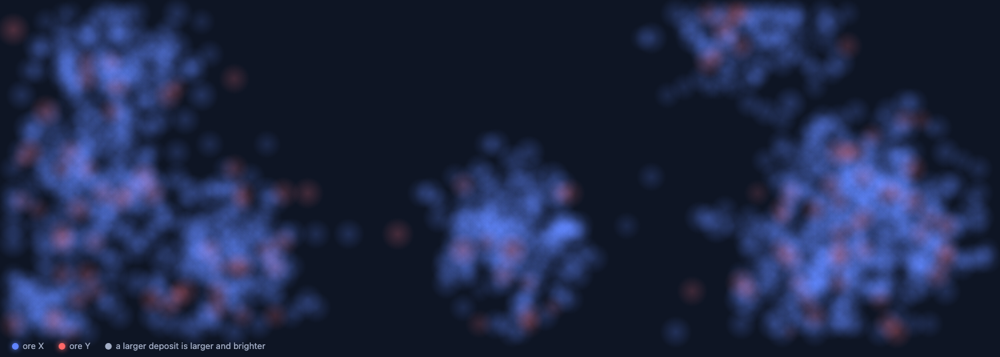
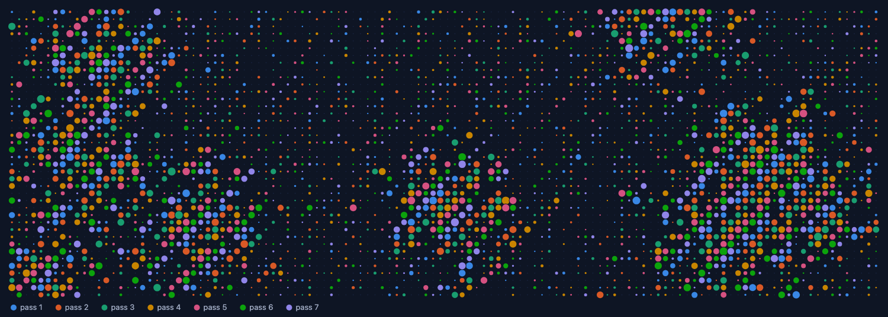
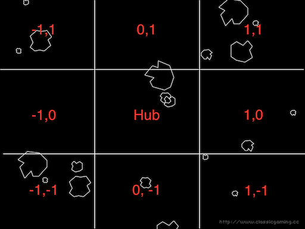
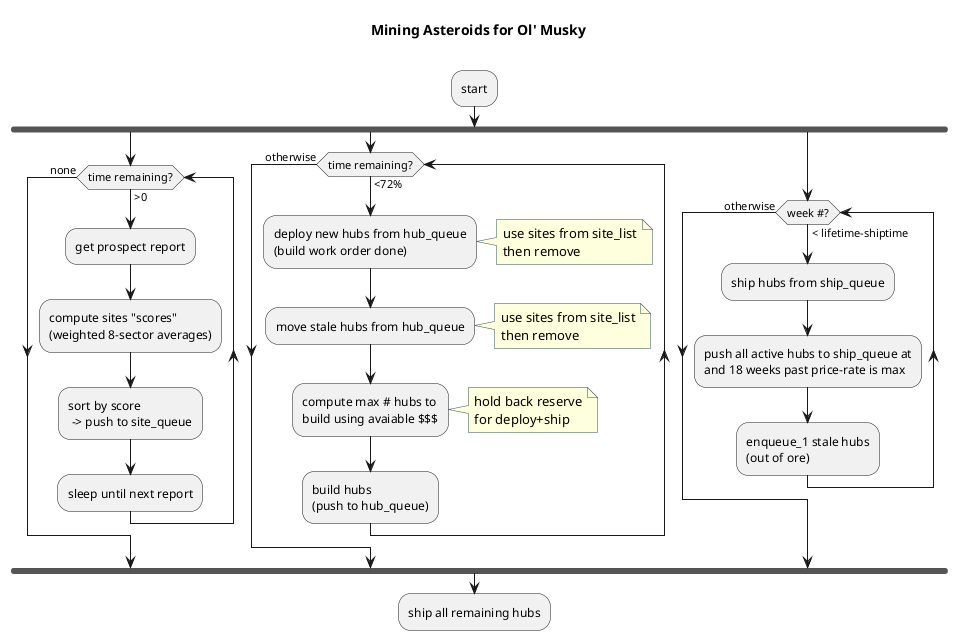

## Redevelopment (2026)

The game server is being built again from an empty start, one layer at a time. Each layer has its own tests and depends only on the layers before it. The competition text and the API specification below describe the game as this server supplies it.

**Design**

The engine follows the dataflow idea of the Lucid language: a value is a stream, and an operation applies to streams point by point.

- The belt is a stream of asteroids; the index is the sector ID.
- `miners` is a sparse stream in parallel with the belt: at each sector, the hub of each bot that is there.
- A world is the state of one player in one week. Each player has their own world.
- `sweep(world)` gives the world of the next week. It goes along the asteroid stream and mines with each bot that it finds. `weeks(world)` is the stream of worlds.
- State is where things are. A hub mines because its bots are in `miners`; there are no status flags, and the sweep has no conditional statements. The limits are arithmetic: a bot takes the minimum of its rate, the deposit, and the free space of its hub.
- All values are immutable. A command or a sweep returns a new world.

**Status**

|Layer|Module|Scope|State|
|:---:|---|---|:---:|
|1|`sweep.py`|Mining: the weekly sweep along the asteroid stream|done|
|2|`placement.py`|Belt geometry; `claim`, `land`, `lift`; placement rules|done|
|3|`timeline.py`|Events by week; `advance` = sweep, then the events of the new week|done|
|4|`ledger.py`, `market.py`, `game.py`|Money, ore prices, and the player commands `build`, `deploy`, `move`, `ship`|done|
|5|`reports.py`, `clock.py`|Status, ledger, market, parameters and prospecting views; the clock of a team|done|
|6|`scenario.py`, `league.py`, `server.py`|Scenario and team files; teams and their clocks; the HTTP API|done|
|7|`spectator.py`, `pages/spectator.html`|Spectator page: the ore of the belt, the hubs that mine, and a bar chart of the balances, live|done|
|8|-|Admin functions, guide page, export of results|next|

`world.py` holds the immutable values (`World`, `Asteroid`, `Hub`, `Terms`), and `rejection.py` holds the error for a command that breaks a rule. All modules are in `src/ol_musky/`. Piracy and insurance are not in the game at this time.

**Time.** There is no universal clock and no timer. Each team has its own clock, which starts when the team calls `/mcp/startup`; a team can start again as frequently as it wants. The server calculates the world of the team's current week when a request asks for it.

**Run the server** (requires [uv](https://docs.astral.sh/uv/) and Python 3.12)

```sh
uv sync
uv run ol-musky                 # spectator page at http://127.0.0.1:8000, API docs at /docs
curl 'http://127.0.0.1:8000/mcp/startup?token=dev'
curl 'http://127.0.0.1:8000/mcp/build_hubs?token=dev&hubs=A'
curl 'http://127.0.0.1:8000/mcp/status_report?token=dev'
```

The server reads `config/mcp.yaml` (the scenario and its belt file) and `config/teams.yaml` (API token and name of each team) at start. The environment variables `OL_MUSKY_SCENARIO`, `OL_MUSKY_TEAMS`, `OL_MUSKY_HOST` and `OL_MUSKY_PORT` change the files and the address. The state is in memory only.

**Spectator page.** `http://127.0.0.1:8000/` shows the belt and a bar chart. The belt has a haze of the ore at the start of a game (one colour for each ore type; a larger deposit is larger and brighter), and a square for each hub that mines, in the colour of its team. Hubs that are idle or in transit are not in the graphic. The bar chart has one bar for each team, for its balance, with the week of the team below its name; a dashed line shows the starting capital. The teams are in the sequence of their names, so that a bar and its colour stay in the same position. After eight teams the colours start again with outlined bars and hubs, and then with striped ones. Point at a team, or click it, to show only that team in the belt and to see its details. The page reads `/spectator/state` one time each second and `/spectator/belt` one time. The data has no API tokens. The players do not have access to this page during a competition; the server does not restrict access to it.

The tools in `admin/` and the guide page in `templates/` are from the 2018 server. They stay unchanged until the application is complete.

**Development**

```sh
uv run pytest
uv run ruff check . && uv run ruff format --check src tests
```

---

# Canadian Engineering Competition 2018

**Programming Challenge**

## Mining Asteroids for Ol' Musky

### Competition

Your mandate is to develop an autonomous asteroid mining system (AI) that makes the most money with the fewest resources for the Ol' Musky Mining Company.  

Starting with $175,000,000 of capital, your AI will interface with Ol' Musky's **Master Control Program (MCP)** which will carry out your instructions and queries for **all** phases of your mining operation. Your AI will be responsible for building and deploying robotic mining hubs in the asteroid belt between Mars and Jupiter and shipping the ore back to Earth. Your task is basically engineering a Supply Chain Management AI. Easy, eh?


 **Fig 1. Sample distribution of ore deposits**

### Operations (What your AI will do)

**Your AI will be completely autonomous**; i.e. once initiated, it will run entirely on its own without input or intervention until the time limit has been reached. Time is measured by the MCP in weeks where 1 MCP week = 200ms of real time. Each run is 600 MCP weeks which is about 2 minutes of real time. Your clock starts when your AI calls /mcp/startup, and each team has its own clock. During development, you may run your AI as often as you require.

Think about what an "autonomous" architecture means: input -> decision -> action.

_NOTE: During your presentation, your AI will run only once with entirely different parameters._

### Interfacing with the MCP (How your AI will work)

All communication with the MCP is done through its RESTful API. Your code can be written in any compiled or interpreted language or script. There are some language docs for HTTP requests in the [Language reference](#language_refs).

- All responses from the MCP are in JSON format (structures in API Specification)
- All MCP instructions cost time and money (see Costs) but the reports are free

### MCP API Overview (The tools your AI will use)

- **Startup (Initialization)**
  - The /mcp/startup API call bootstraps your AI's profile on the MCP and cleans out all historical data and starts the clock.
  - This must be the first call your AI makes for each run.
  - The MCP's response from /mcp/startup is a status report (see /mcp/status_report)

- **Parameters (MCP Constants)**
  - The /mcp/parameters API simply dumps all the constants used by the MCP. These parameters may change slightly during development so your AI should not treat them as hard-coded. You will be clearly notified of any changes. However, for your presentation, the parameters will be significantly different.
    - Competition lifetime (in weeks)
    - Asteroid belt segment size in rows and columns
    - Hub capacity in tonnes
    - Rate of mining in tonnes/per bot/per week
    - Real time vs MCP time factor in ms/week
    - Costs of all actions in dollars and time (see Costs)

- **Prospecting Report (Exploration)**
  - Using the /mcp/prospect_report API function, your AI will get data from on-going geological surveys and test bore-holes in the asteroid belt. The report is a list of sectors, the ore type found and an estimate of size of ore deposit in each sector. However, each report contains only a subset of the total sectors
  - A new report is available every 85 MCP weeks progressively covering more of the belt.
  
  **Fig 2. Example of one prospect report - a diagonal exploratory "pass"**
  
  **Fig 3. Each colour represents a separate prospecting report pass (7 in all)**

- **Build Hubs, Deploy Hubs and Move Hubs (Development)**
  - Construct hubs using the /mcp/build_hubs and deploy them to the asteroid belt using /mcp/deploy_hubs APIs.
  - Note: hubs automatically distribute their mining bots and initiate the ore accumulation
  - If a hub runs out of ore to mine, your AI can move the hub using the /mcp/move_hubs API function.
  - Important: Each of these actions is scheduled by the MCP in a work order that takes time to complete. See Costs.
  - A list of all of pending work orders is included in the /mcp/status_report

- **Status Report (Active mining/ore extraction)**
  - The /mcp/status_report provides a snapshot of your operation including your bank balance at the time of the report.
    - Team attributes
    - Financial (see below)
    - List of hubs, their state (idle, in transit or mining), their sector IDs, the space remaining in the hub and amount of accumulated ore
    - List of outstanding work-orders

- **Get Ledger (Financials)**
  - The /mcp/get_ledger is exaclty that - your accounting ledger. It's not something your AI should be checking frequently because it can get rather large as time goes on.
  
      |week|item|debit|credit|balance|
      |:---:|:---:|:---:|:---:|:---:|
      |0|startup|0|150|150|
      |1|build|hubs|45|0|105|
      |20|deploy|hubs|66|0|39|

- **Ship Ore (Production)**
  - Ship ore from the hubs back to Earth as hubs fill up
  - The /mcp/market_report has the current ore prices
  - Note: The MCP schedules rocket trips between Earth and the belt as part of the work order

- **Costs**
    |Action|Cost (x millions)|Time (weeks)|
    |:---:|:---|:---:|
    |Build a Hub|$20 per hub|5|
    |Deploy a Hub|$30 per hub|17|
    |Move a Hub|$10 per hub|2|
    |Ship Ore|$1.5 per 1000 tonnes|18|

  These are the values of the development scenario (`config/mcp.yaml`). The /mcp/parameters API gives the values that are in effect.

- **Revenue**
  - On Earth, the minerals are automatically extracted from the ore and sold (revenue) at the market value upon arrival.
  - The revenue from ore sales is deposited directly into your account and is reflected in the ledger

### Constraints

- each hub has 8 robotic miners (bots)
- bots may only mine the 8 sectors adjacent to their parent hub (see Example Hub Placement)
- bots may not mine the sector on which the hub is deployed
- bots cannot simultaneously mine the same sectors
- mining stops when a hub is full, the ore is depleted or when a hub is being deployed or moved
- the capacity of a hub is the total of all ore types; a full hub does not deplete its sectors
- hubs in transit hold their destination: you cannot deploy a different hub to sectors that touch it

## Tips:

- To avoid disqualification through inadvertently DDoSing the server, we recommend your AI checks the status of your orders (in the /mcp/status_report) with a reasonable frequency since the report is updated only once per MCP week (200ms).
- Related to DDoS, also keep an eye on how much data you transmit to the MPC - it doesn't have unlimited bandwidth
- Keep in mind your goal is to earn the most money, so partition your development tasks wisely.
- Be aware that timing won't be exact. Code takes time to execute, data takes time to transmit and networks have contention.
- Before you ask for help with the MCP, check for "garbage in; garbage out" first.
- This is a complex problem so to save valuable presentation time we recommend omitting the problem description from your presentation

## Rules

**As always, violating any rules will result in immediate disqualification**

- Your security api token may be transmitted ONLY to the MCP host URL and must originate from the hotel WiFi.
- NO HACKING the MCP server.
- NO DDoS attacks on the MCP server or other competitors.

### Submission

- The required output from your AI is a time-stamped log of the HTTP requests transmitted in the format: YYYY-MM-DD HH:MM:SS URI
- e.g.
2018-02-09 21:34:13 https://www.cec-2017.ca/mcp/startup?token=71a653928dc1152537d002cd1349f0d4
- All teams must submit their final log file and code in a zip file emailed to dmarchese@ryerson.ca no later than 6:01pm EST on March 9, 2018. Late submissions will not be accepted.

#### Getting Started

1. Obtain a security API access token from the competition coordinator
2. Start coding - the very first API request your code should make is "/mcp/startup" so that each time your code runs, your team's profile and historical data are bootstrapped (reset).

#### Scoring

Objective scoring is based solely on profit (Revenues - Expenses)

**Judging Criteria**

>omitted

---

## Appendix

### API Specification

All calls to the MCP are HTTP GET and use this format:

`http://127.0.0.1:8000/mcp/[api]?token=[security api token]`

- Lists are comma-separated, for example `hubs=A,B&sector_ids=120,853`.
- A hub ID has 8 or fewer characters: letters, digits, `-` and `_`.
- All responses are JSON with HTTP status 200, in this envelope:

  ```json
  {"<api>": <data>, "status": <code>, "description": "<text>"}
  ```

  `status` 0 is success. Other values are in [MCP Response Status Codes](#mcp-response-status-codes). For an error with a code below 2000, and for "times up", the first key is `validation`.
- Money is in millions of dollars. Ore is in tonnes.

- **Startup**

  `GET /mcp/startup?token=[api_token]`

  Starts your game again and starts your clock: week 0, the starting capital, no hubs, no history. You can call it as frequently as you want. The response is a status report.

  ```json
  {
    "startup": {
      "team": {
        "token": "71a653928dc1152537d002cd1349f0d4",
        "name": "testgremlins",
        "week": 0,
        "start_time": "2018-03-09 14:00:00+00:00",
        "balance": 175
      },
      "hubs": {},
      "orders": []
    },
    "status": 0,
    "description": ""
  }
  ```

- **Status Report**

  `GET /mcp/status_report?token=[api_token]`

  The most important of all requests. It includes:

  - `team`: your team, your current week, and your balance.
  - `hubs`: each hub that you have. Key info about each hub:
    - `state`: `"idle"` (not deployed), `"in_transit"` (it goes to a sector and does not mine), or `"mining"`.
    - `sector_id`: the sector that the hub holds: where it mines, or where it goes to. It is `null` for an idle hub.
    - `amt`: the accumulated ore of each ore type.
    - `space_remaining`: how much of the hub capacity is free (%). The capacity is the total of all ore types.
  - `orders`: the pending work orders, in the sequence of their completion weeks. An order that is complete is not in the list.
    - `deliver_hubs`: new hubs arrive from the factory (`hub_list`).
    - `relocate_hubs`: a hub arrives at its sector and starts to mine (`hub_list`, `sector_id_list`). Each hub has its own order.
    - `sell_ore`: a shipment arrives on Earth and sells (`ore_load`).

  Example response, 3 weeks after a deploy of hubs A and B:

  ```json
  {
    "status_report": {
      "team": {
        "token": "71a653928dc1152537d002cd1349f0d4",
        "name": "testgremlins",
        "week": 8,
        "start_time": "2018-03-09 14:00:00+00:00",
        "balance": 75
      },
      "hubs": {
        "A": {
          "hub_id": "A",
          "state": "in_transit",
          "sector_id": 3503,
          "amt": {},
          "space_remaining": 100
        },
        "B": {
          "hub_id": "B",
          "state": "in_transit",
          "sector_id": 853,
          "amt": {},
          "space_remaining": 100
        }
      },
      "orders": [
        {
          "week": 22,
          "action": "relocate_hubs",
          "hub_list": ["A"],
          "sector_id_list": [3503]
        },
        {
          "week": 22,
          "action": "relocate_hubs",
          "hub_list": ["B"],
          "sector_id_list": [853]
        }
      ]
    },
    "status": 0,
    "description": ""
  }
  ```

  Example response when hub A mines, its first shipment is on its way to Earth, and hub B moves to a new sector:

  ```json
  {
    "status_report": {
      "team": {
        "token": "71a653928dc1152537d002cd1349f0d4",
        "name": "testgremlins",
        "week": 43,
        "start_time": "2018-03-09 14:00:00+00:00",
        "balance": 27.5
      },
      "hubs": {
        "A": {
          "hub_id": "A",
          "state": "mining",
          "sector_id": 3503,
          "amt": {"X": 2681, "Y": 383},
          "space_remaining": 87
        },
        "B": {
          "hub_id": "B",
          "state": "in_transit",
          "sector_id": 1500,
          "amt": {"Y": 3830, "X": 21170},
          "space_remaining": 0
        }
      },
      "orders": [
        {
          "week": 44,
          "action": "relocate_hubs",
          "hub_list": ["B"],
          "sector_id_list": [1500]
        },
        {
          "week": 60,
          "action": "sell_ore",
          "ore_load": {"X": 21936, "Y": 3064}
        }
      ]
    },
    "status": 0,
    "description": ""
  }
  ```

- **Final Report**

  `GET /mcp/final_report?token=[api_token]`

  The status report with your ledger: `team`, `hubs`, `orders`, `ledger`. It is available after the end of the game.

- **Get Ledger**

  Your accounting ledger.

  `GET /mcp/get_ledger?token=[api_token]`

  ```json
  {
    "ledger": [
      {
        "week": 0,
        "item": "startup",
        "credit": 175,
        "debit": 0
      },
      {
        "week": 0,
        "item": "build hubs",
        "credit": 0,
        "debit": 40
      },
      {
        "week": 5,
        "item": "deploy hubs",
        "credit": 0,
        "debit": 60
      },
      {
        "week": 42,
        "item": "ship ore",
        "credit": 0,
        "debit": 37.5
      },
      {
        "week": 42,
        "item": "move hubs",
        "credit": 0,
        "debit": 10
      },
      {
        "week": 60,
        "item": "sell ore",
        "credit": 52.9328,
        "debit": 0
      }
    ],
    "status": 0,
    "description": ""
  }
  ```

- **Parameters**

  These are the constants of the scenario. The costs are __per hub__ except for _ship_, which is the cost __per 1000 tonnes__ of ore. `prospect_weeks` is the number of weeks between new prospecting reports.

  `GET /mcp/parameters?token=[api_token]`

  ```json
  {
    "parameters": {
      "lifetime": 600,
      "rows": 40,
      "cols": 120,
      "hub_capacity": 25000,
      "mining_rate": 383,
      "starting_capital": 175,
      "prospect_weeks": 85,
      "costs": {
        "build": {
          "item": "build",
          "weeks": 5,
          "rate": 20
        },
        "deploy": {
          "item": "deploy",
          "weeks": 17,
          "rate": 30
        },
        "move": {
          "item": "move",
          "weeks": 2,
          "rate": 10
        },
        "ship": {
          "item": "ship",
          "weeks": 18,
          "rate": 1.5
        }
      },
      "ms_per_week": 200
    },
    "status": 0,
    "description": ""
  }
  ```

- **Prospecting Report**

  `GET /mcp/prospect_report?token=[api_token]`

  Each element of the report is `[sector_id, ore_type, estimated_tonnes]` (zero-based sector IDs).

  - The report shows only the sectors of the current survey pass; it does not repeat the sectors of previous passes. A new pass starts each `prospect_weeks` weeks.
  - A second request in the same pass gives the same estimates.
  - An estimate is for the ore that is in the sector at this time, with an error of approximately 15 % of the largest deposit.

  ```json
  {
    "prospect_report": {
      "report": [
        [0, "Y", 10744],
        [7, "X", 52365],
        [14, "X", 51916],
        [21, "X", 0],
        ...,
        [4788, "Y", 116749],
        [4795, "X", 20547]
      ]
    },
    "status": 0,
    "description": ""
  }
  ```

- **Market Report**

  `GET /mcp/market_report?token=[api_token]`

  Ore prices change weekly. A price is for 1000 tonnes. Ore sells at the prices of the week in which the shipment arrives.

  ```json
  {
    "market_report": {
      "week": 42,
      "prices": {"X": 2.66, "Y": 7.01}
    },
    "status": 0,
    "description": ""
  }
  ```

- **Build Hubs**

  `GET /mcp/build_hubs?token=[api_token]&hubs=[H0,H1,...Hn]`

  You select the hub IDs. Each ID must be new.

  ```json
  {
    "build_hubs": {
      "hubs_built": 2,
      "week": 0
    },
    "status": 0,
    "description": ""
  }
  ```

- **Deploy Hubs**

  `GET /mcp/deploy_hubs?token=[api_token]&hubs=[H0,H1,...Hn]&sector_ids=[s0,s1,...,sn]`

  Hub *n* goes to sector *n*. The number of sector IDs must be the same as the number of hub IDs.

  - A hub holds its sector and the adjacent sectors from the time of the request. These sectors must not touch the sectors that a different hub of yours holds.
  - If one hub in the request is rejected, the full request is rejected and you pay nothing.
  - A hub that is in transit cannot get a new deploy or move request.

  ```json
  {
    "deploy_hubs": {
      "hubs_located": 2
    },
    "status": 0,
    "description": ""
  }
  ```

- **Move Hubs**

  `GET /mcp/move_hubs?token=[api_token]&hubs=[H0,H1,...Hn]&sector_ids=[s0,s1,...,sn]`

  The same as Deploy Hubs, for hubs that mine, at the move cost. The hub stops mining and releases its sectors immediately. It keeps its ore.

  ```json
  {
    "move_hubs": {
      "hubs_located": 1
    },
    "status": 0,
    "description": ""
  }
  ```

- **Ship Ore**

  `GET /mcp/ship_ore?token=[api_token]&hubs=[H0,H1,...Hn]`

  Empties the hubs and sends the ore to Earth. The hubs continue to mine.

  ```json
  {
    "ship_ore": {
      "hubs_dumped": 1,
      "ore": {"X": 21936, "Y": 3064}
    },
    "status": 0,
    "description": ""
  }
  ```

- **Errors**

  An error has a status that is not 0, and a description. Example: a deploy to a sector that touches the sectors of hub A.

  ```json
  {
    "deploy_hubs": {
      "hubs_located": 1
    },
    "status": 0,
    "description": ""
  }
  ```

  After the last week of the game, each request other than `startup`, `parameters`, `final_report` and `get_ledger` gets this response:

  ```json
  {
    "validation": {
      "week": 661,
      "max": 600
    },
    "status": -1,
    "description": "times up"
  }
  ```

#### Language reference for HTTP requests

If this is your first time making get requests; checkout the following language docs:

[Ruby](https://github.com/httprb/http)
[Python](http://docs.python-requests.org/en/master/)
[Java](https://hc.apache.org/httpcomponents-client-ga/index.html)

##### Example Hub placement showing adjacent sectors (Cartesian co-ordinates)


#### MCP Response Status Codes

|Action|Code|Description|
|---|---|---|
|all|-1|times up: the game is over|
|validation|1000|token must be 32 or fewer alpha-numerics|
|validation|1001|token required - see competition coordinator|
|validation|1100|unknown team|
|validation|1102|team has not started: call /mcp/startup|
|startup|2100|unknown team|
|build_hubs|2301|not enough money|
|build_hubs|2302|hub IDs must be new, not repeated, and 8 or fewer alpha-numerics|
|deploy/move|2400|the hub list or the sector_id list is missing|
|deploy/move|2401|hub list and sector_id list need to be the same length|
|deploy/move|2402|a hub does not exist, or a hub ID is repeated|
|deploy/move|2403|hub is in transit|
|deploy/move|2404|a sector ID is not numeric or is outside the belt|
|deploy/move|2407|place is taken: the sectors touch the sectors of a different hub|
|move|2408|hub has no place: deploy it before you move it|
|deploy/move|2409|not enough money|
|ship_ore|2501|no hubs in the request|
|ship_ore|2502|no ore to ship|
|ship_ore|2503|not enough money|
|ship_ore|2504|unknown hub|


